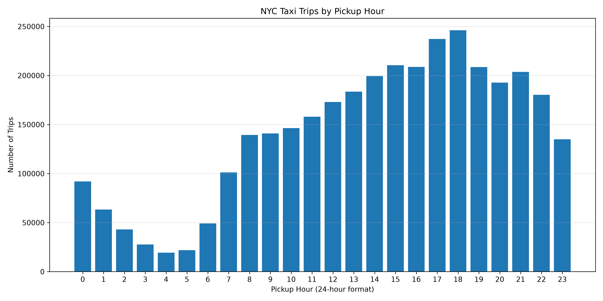

# NYC Taxi Data Analytics — January 2025

## Project Overview

This project analyzes January 2025 NYC Yellow Taxi trip data using Python, MySQL, and data visualization. The goal is to identify trip patterns, understand fare trends, and discover insights that could help improve operational planning.

## Tools Used

* **Python:** Data cleaning, processing, and visualization
* **Pandas and PyArrow:** Reading and processing Parquet data
* **MySQL:** Data storage and SQL analysis
* **Matplotlib:** Creating charts

## Dataset

The project uses NYC TLC Yellow Taxi trip data for January 2025. The data was cleaned by filtering invalid trip durations, nonpositive distances, missing required fields, and trips outside the January date range.

* **Analysis period:** January 1–31, 2025
* **Cleaned trips analyzed:** 3,381,698

## Key Findings

* **Total trips:** 3,381,698
* **Average trip distance:** 6.01 miles
* **Average trip duration:** 14.69 minutes
* **Average base fare:** $17.06
* **Total base-fare revenue:** $57,700,865.07
* **Average total customer payment:** $25.67

### Day-of-Week Insights

* Thursday had the highest total trip count.
* Thursday also had the highest total base-fare revenue.
* Monday had the highest average base fare.
* Saturday had the lowest average base fare.

## Visualizations

The project includes an hourly trip-demand chart generated using Python and Matplotlib.

## Project Structure

* `data/` — Source dataset
* `scripts/` — Python scripts for loading, analyzing, and visualizing data
* `outputs/` — Generated charts
* `README.md` — Project documentation

## Limitations

This analysis uses NYC Yellow Taxi data as a proxy for ride-hailing analytics. Base-fare revenue is not the same as total customer payments or business profit. The findings describe January 2025 and may not represent other months.

## Conclusion

This project demonstrates an end-to-end data analytics workflow involving data cleaning, MySQL database management, SQL analysis, and Python visualization.
